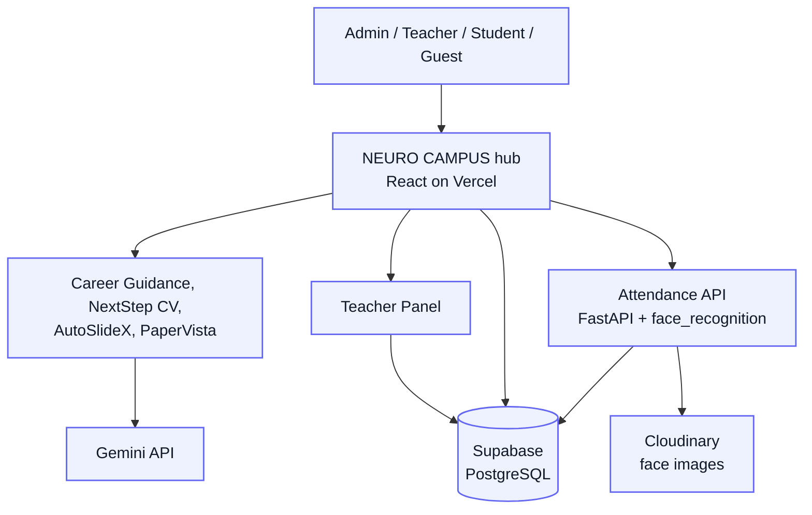

# NEURO CAMPUS: Student Campus Cloud Network


**A campus management suite for a university: role-based portals (Admin, Teacher, Student, Guest), face-recognition attendance, fee tracking, and AI tools for exam papers, slides, resumes and career guidance.**

Final-year B.Tech (CSE, AI & ML) major project at Shri Vaishnav Vidyapeeth Vishwavidyalaya, Indore.

**Live hub:** [neuro-campus-73w8.vercel.app](https://neuro-campus-73w8.vercel.app/) | **Guest portal needs no login.**

> This repository is an **umbrella repo**. Each application lives in its own repository and is pinned here as a git submodule.

---

## What's in the suite

| Module | What it does | Stack | Live | Source |
| --- | --- | --- | --- | --- |
| **NEURO CAMPUS** (hub) | Role-based portals, fees, library, canteen, forum links | React, Vite, Tailwind, Supabase, Clerk | [Open](https://neuro-campus-73w8.vercel.app/) | [jiyanshuj/NEURO_CAMPUS](https://github.com/jiyanshuj/NEURO_CAMPUS) |
| **Attendance API** | Face-recognition attendance (register, train, recognize, sessions, reports) | FastAPI, face_recognition (dlib), OpenCV, Supabase, Cloudinary | n/a | [`/backend`](backend/) |
| **Teacher Panel** | Teacher login, subjects, grades, attendance UI | React, TypeScript, Vite, Supabase | n/a | [teacher-panel](https://github.com/jiyanshuj/teacher-panel) |
| **Smart Career Guidance** | 30-question aptitude quizzes across 6 domains, analytics, career path | React, TypeScript, Flask, Clerk, Gemini | [Open](https://smart-career-guidance-system.vercel.app/) | [repo](https://github.com/jiyanshuj/Smart-Career-Guidance-System) |
| **NextStep CV** | Multi-template resume builder, PDF/DOCX export | React, TypeScript, Vite, Flask, python-docx, Gemini | [Open](https://nextstep-resume.netlify.app/) | [Resume-Gen](https://github.com/jiyanshuj/Resume-Gen) |
| **AutoSlideX** | Topic to editable outline to .pptx | React, Vite, FastAPI, python-pptx, Gemini | [Open](https://auto-slide-x.vercel.app/) | [repo](https://github.com/jiyanshuj/AutoSlideX) |
| **PaperVista** | MST-1 / MST-2 / End-Sem question paper generator | React, Vite, FastAPI, Pydantic, Gemini | [Open](https://paper-vista-five.vercel.app/) | [repo](https://github.com/jiyanshuj/PaperVista) |
| **Admin Panel** | Student/teacher entry, face enrollment, subjects, fees | React, Vite, Tailwind, FastAPI | n/a | [Major-project](https://github.com/jiyanshuj/Major-project) (private or in development) |

Also integrated, in separate repositories: [E-Library](https://github.com/Yug-Bothra/Eliberary), [E-Canteen](https://github.com/Yug-Bothra/project), [Quiz App](https://github.com/Yug-Bothra/quizz), [FORAM (student forum)](https://github.com/Yug-Bothra/FORAM).

## Try it

- **Guest portal:** open the live hub and choose *Guest / Visitor*. No account needed (campus info, map, E-Canteen, E-Visit).
- **Admin, Teacher and Student portals:** demo accounts are shared on request via [LinkedIn](https://www.linkedin.com/in/jiyanshu-jain). Credentials are intentionally not published in this repository.

## Architecture



### Data model

Data is split across several Supabase schemas rather than one monolithic database:

| Schema | Tables |
| --- | --- |
| `public` | `students`, `attendance`, `class_sessions`, `attendance_monthly`, plus forum, library and canteen tables |
| `teacher_db` | `teachers`, `teacher_auth`, `subjects`, `teacher_subjects` |
| `admin_db` | `admins`, `admin_audit_log` |
| `accounts_db` | `accounts`, `payments` (linked to `public.students.enrollment_number`) |

### Intended role permissions

| Feature | Admin | Teacher | Student | Guest |
| --- | :-: | :-: | :-: | :-: |
| Add/assign teachers, students, subjects | Yes | No | No | No |
| Attendance (take / view) | Yes | Yes | View own | No |
| AI notes, PPT, exam paper tools | Yes | Yes | Notes only | No |
| Fees and transactions | Yes | No | Own | No |
| Evaluate students | No | Yes | No | No |
| Library, quizzes | No | Yes | Yes | No |
| Canteen, campus info | Yes | Yes | Yes | Yes |

## Face-recognition attendance

1. A student or teacher is registered with at least 5 face images, stored in Cloudinary.
2. `/train` builds a face-encoding model per section and semester (or for all teachers).
3. A teacher starts a session; every student is auto-marked absent.
4. `/attendance/recognize-and-mark` and `/attendance/recognize-multiple-and-mark` identify faces from a camera frame and mark students present or late with a confidence score.
5. Reports: per student, per subject, daily, and low-attendance lists (default threshold 75%).

**Measured recognition accuracy: 60%.** The evaluation method is not documented yet; see [Known limitations](#known-limitations). Location-based verification is a feature of the teacher flow and is not part of the API in `/backend`.

<details>
<summary><b>Attendance API endpoints</b></summary>

| Method | Endpoint | Purpose |
| --- | --- | --- |
| POST | `/register/student`, `/register/teacher`, `/register/guest` | Register a person with face images |
| POST | `/train` | Train the recognition model |
| POST | `/test`, `/test-multiple` | Recognize one or many faces in an image |
| POST | `/attendance/start-session`, `/attendance/end-session` | Manage a class session |
| GET | `/attendance/active-session` | Active session and records |
| POST | `/attendance/mark-present`, `/attendance/mark-absent` | Manual marking and overrides |
| POST | `/attendance/recognize-and-mark`, `/attendance/recognize-multiple-and-mark` | Recognize faces and mark attendance |
| GET | `/attendance/session/{id}`, `/attendance/student/{enrollment}` | Session and student history |
| GET | `/attendance/subject-stats`, `/attendance/daily-report`, `/attendance/low-attendance` | Reports |
| POST | `/attendance/update-summary` | Recompute a student's summary |

</details>

## Screenshots

Admin portal:

<table>
  <tr>
    <td align="center" width="50%"><br><sub><b>Role selection portal</b></sub></td>
    <td align="center" width="50%"><br><sub><b>Admin sign-in</b></sub></td>
  </tr>
  <tr>
    <td align="center"><br><sub><b>Teacher management</b></sub></td>
    <td align="center"><br><sub><b>Student management</b></sub></td>
  </tr>
  <tr>
    <td align="center"><br><sub><b>Subject management</b></sub></td>
    <td align="center"><br><sub><b>Teacher-subject assignment</b></sub></td>
  </tr>
</table>

Teacher, library, canteen and guest portals:

<table>
  <tr>
    <td align="center" width="50%"><br><sub><b>Teacher: subjects and classes</b></sub></td>
    <td align="center" width="50%"><br><sub><b>Teacher: face-recognition attendance</b></sub></td>
  </tr>
  <tr>
    <td align="center"><br><sub><b>E-Library home</b></sub></td>
    <td align="center"><br><sub><b>AI study-notes generator</b></sub></td>
  </tr>
  <tr>
    <td align="center"><br><sub><b>E-Canteen menu</b></sub></td>
    <td align="center"><br><sub><b>E-Canteen cart</b></sub></td>
  </tr>
  <tr>
    <td align="center"><br><sub><b>Guest portal landing</b></sub></td>
    <td align="center"><br><sub><b>Guest: contact and map</b></sub></td>
  </tr>
</table>

AI tools:

<table>
  <tr>
    <td align="center" width="50%"><br><sub><b>Career Guidance: landing</b></sub></td>
    <td align="center" width="50%"><br><sub><b>Career Guidance: results and recommended path</b></sub></td>
  </tr>
  <tr>
    <td align="center"><br><sub><b>NextStep CV: templates</b></sub></td>
    <td align="center"><br><sub><b>AutoSlideX: editable outline</b></sub></td>
  </tr>
  <tr>
    <td align="center"><br><sub><b>AutoSlideX: generated .pptx</b></sub></td>
    <td align="center"><br><sub><b>PaperVista: generated questions</b></sub></td>
  </tr>
</table>

## Run locally

```bash
git clone --recurse-submodules https://github.com/jiyanshuj/NEURO-CAMPUS-CLOUD-NETWORK.git
cd NEURO-CAMPUS-CLOUD-NETWORK
git submodule update --init --recursive   # if you cloned without the flag
```

Each front end is its own project; see its README. Typical flow:

```bash
cd NEURO_CAMPUS && npm install && npm run dev
```

### Attendance API

```bash
cd backend
python -m venv venv
source venv/bin/activate        # Windows: venv\Scripts\activate
pip install -r requirements.txt
uvicorn main:app --reload --host 0.0.0.0 --port 8000
```

Create `backend/.env` (never commit it):

```env
SUPABASE_URL=...
SUPABASE_KEY=...
CLOUDINARY_CLOUD_NAME=...
CLOUDINARY_API_KEY=...
CLOUDINARY_API_SECRET=...
```

Python dependencies: `face-recognition 1.2.3`, `dlib-bin 19.24.6`, `opencv-python-headless 4.8.1`, `fastapi 0.104.1`, `supabase 2.3.0`, `cloudinary 1.36.0`, `numpy 1.24.3`.

## Known limitations

This is a student major project. These gaps are known and are the next things to fix:

| Area | Current state | Planned fix |
| --- | --- | --- |
| **API authentication** | Attendance API endpoints (register, train, mark-present, reports) have no auth. | Verify Supabase JWT on every route and enforce role checks server-side. |
| **CORS** | `allow_origins=["*"]` with credentials enabled. | Restrict to the deployed hub origin via an env variable. |
| **PII in logs** | Registration endpoints `print()` names, enrollment numbers, emails, mobile numbers, fees and salary. | Remove, use structured logging with redaction. |
| **Error handling** | Internal exceptions are returned to clients as `str(e)`. | Return generic errors, log details server-side. |
| **Upload validation** | No type or size limit on face images. | Pillow verification, JPG/PNG only, size cap, as in [Kardivo](https://github.com/jiyanshuj/Kardivo). |
| **Recognition accuracy** | 60%, with no documented evaluation set or threshold tuning. | Hold-out evaluation, tune distance threshold, report precision and recall. |
| **Admin API hosting** | Admin panel reaches its FastAPI backend through an ngrok tunnel. | Deploy the API to a stable host (Render, Railway or a VM). |
| **Tests and CI** | No automated tests or CI pipeline. | pytest for attendance logic, GitHub Actions for lint, build and tests. |
| **Sensitive fields** | Salary and biometric data are stored alongside ordinary profile data. | Separate tables with row-level security, encrypt biometric data. |
| **Dependencies** | `requirements.txt` does not include scikit-learn or TensorFlow. | Document exactly how KNN matching is done, drop unused libraries from the docs. |

## Team

Major project by CSE-AIML students, guided by Prof. Pooja Deshpande, Assistant Professor, Department of Computer Science Engineering.

| Name | Enrollment | Role |
| --- | --- | --- |
| Devashish Moghe | 22100BTAIMLM11244 | Full-stack |
| JaiVardhan Kumrawat | 22100BTAIMLM11252 | Backend |
| Jiyanshu Jain | 22100BTAIMLM11253 | AI/ML |
| Yug Bothra | 22100BTAIMLM11277 | Frontend |

## License

Developed for academic purposes. All rights reserved by the development team unless a module repository states otherwise.

---

**Author:** [Jiyanshu Jain](https://github.com/jiyanshuj) | [Portfolio](https://jiyanshu.dev) | [LinkedIn](https://www.linkedin.com/in/jiyanshu-jain)
